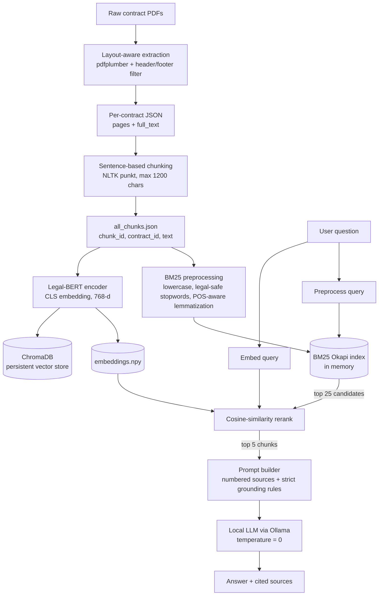

# Contract Intelligence RAG: Hybrid Retrieval for Contract Question Answering

A local, end-to-end Retrieval-Augmented Generation (RAG) pipeline that answers questions about commercial contracts (PDFs) with **grounded, source-cited answers**. It combines **BM25 lexical search** with **Legal-BERT embedding reranking**, then passes the top evidence to a **local LLM (Ollama)** that is constrained to answer only from the retrieved text.

> **Why this matters:** contract questions ("How many credits does the client get?", "Is there a termination-for-convenience clause?") hinge on exact numbers, dates, and negations. A pure semantic search tends to blur those details, and a pure keyword search misses paraphrases. This project uses both, and keeps every answer traceable to a source chunk.

---

## Table of Contents

1. [Highlights](#highlights)
2. [System Architecture](#system-architecture)
3. [Pipeline Walkthrough](#pipeline-walkthrough)
4. [Design Decisions & Trade-offs](#design-decisions--trade-offs)
5. [Tech Stack](#tech-stack)
6. [Project Structure](#project-structure)
7. [Setup & Usage](#setup--usage)
8. [Example Output](#example-output)
9. [Evaluation Plan](#evaluation-plan)
10. [Known Limitations](#known-limitations)
11. [Roadmap](#roadmap)

---

## Highlights

- **Layout-aware PDF ingestion:** word-level coordinates (pdfplumber) strip repeating headers and footers before they pollute chunks.
- **Sentence-boundary chunking:** NLTK `punkt` tokenization keeps clauses intact instead of cutting mid-sentence.
- **Legal-aware text preprocessing:** the stopword list deliberately *keeps* `not, no, never, shall, must, may, will, without, nor`, because they change the meaning of an obligation.
- **Two-stage hybrid retrieval:** BM25 narrows the corpus to 25 candidates, then Legal-BERT cosine similarity reranks to the top 5.
- **Grounded generation:** the LLM is prompted at temperature 0 to answer only from the supplied excerpts, cite `[Source N]`, and refuse when the answer is not present.
- **Fully local:** Ollama + ChromaDB + on-disk artifacts, so no contract text leaves the machine.

---

## System Architecture



### Offline (indexing) vs. online (query) paths

| Phase | Steps | Output |
|---|---|---|
| **Offline / indexing** | Extract, clean, chunk, preprocess, embed, index | `processed/*.json`, `embeddings.npy`, BM25 corpus, Chroma collection |
| **Online / query** | Preprocess query, BM25 top-25, embed query, rerank top-5, prompt LLM | Answer with source chunk IDs, similarity and BM25 scores |

---

## Pipeline Walkthrough

### Step 1: PDF Ingestion
- Prototyped with **PyPDF2**, then moved to **pdfplumber** because it exposes word-level coordinates (`x0, top, x1, bottom`).
- Words are kept only if `100 < top < 700` (points), which removes running headers and footers and page numbers.
- Each contract is saved as `data/processed/<contract_id>.json` with `total_pages`, per-page text, and `full_text`.

### Step 2: Chunking
- **First attempt:** regex split on periods. This breaks on abbreviations and section numbering ("Sec. 4.2", "Inc.").
- **Final approach:** `nltk.sent_tokenize`, with sentences packed greedily into chunks under **1,200 characters**. This is roughly 250 to 300 tokens, comfortably below Legal-BERT's 512-token limit.
- Each chunk carries `chunk_id`, `contract_id`, `chunk_index`, `char_count`, and `file_name` for traceability.

### Step 3: Text Preprocessing (for BM25 only)
- Lowercase, strip punctuation, remove stopwords, then **POS-tag and lemmatize** with WordNet, so "credits" and "credit" and "running" and "run" match.
- Legal-critical modals and negations are removed from the stopword list (see [Design Decisions](#design-decisions--trade-offs)).
- Embeddings are computed from the **raw chunk text**, not the preprocessed text, so the transformer sees natural language.

### Step 4: Indexing
- **BM25Okapi** (`rank-bm25`) over the preprocessed token lists.
- **Legal-BERT** (`nlpaueb/legal-bert-base-uncased`) CLS-token embeddings, saved to `embeddings.npy` and loaded into a persistent **ChromaDB** collection with metadata (`contract_id`, `chunk_index`, `filename`, `char_count`).

### Step 5: Hybrid Retrieval
1. Score all chunks with BM25 and keep the **top 25**.
2. Embed the query with Legal-BERT.
3. Compute **cosine similarity** between the query and each of the 25 candidates.
4. Sort by similarity and return the **top 5**.

### Step 6: Grounded Answer Generation
- The top chunks are formatted as numbered sources: `[Source 1 | contract_01_chunk_7] ...`.
- The system prompt enforces:
  - use **only** the provided excerpts
  - quote numbers, dates, and obligations exactly as written
  - cite `[Source N]`
  - reply *"The provided contract excerpts do not contain this information."* when the evidence is missing
- Generation runs through **Ollama** at `temperature=0` for repeatable output.

---

## Design Decisions & Trade-offs

| Decision | Why | Trade-off |
|---|---|---|
| **Hybrid (BM25 then dense rerank)** instead of dense-only | Contracts are full of exact terms (product names, credit counts, region codes) that BM25 matches reliably. Dense reranking then recovers paraphrases and ranks by meaning. | Recall is capped by the BM25 stage: if the right chunk is not in the top 25 lexically, the reranker never sees it. A parallel dense retrieval fused with RRF would remove that ceiling. |
| **Keep negations and modals** (`not`, `shall`, `must`, `may`, `without`) | "Shall" vs. "may" and "not" flip the legal meaning of a clause. Default stopword lists would erase them. | Slightly larger index and a few more noisy matches. |
| **Header/footer filtering by y-coordinate** | Repeated boilerplate inflates BM25 term frequencies and appears in many chunks. | Fixed thresholds (100 / 700) are tuned to this document layout and may need per-template calibration. |
| **Sentence-boundary chunking** | Preserves complete clauses, which improves both retrieval and the readability of cited sources. | Clauses that span more than 1,200 characters are split, and there is no overlap between chunks. |
| **Domain-specific encoder (Legal-BERT)** | Pre-trained on legal text, so it understands terms like "indemnification" and "force majeure". | It is a masked-LM, not a sentence-embedding model, so CLS-pooled vectors are weaker for similarity than purpose-built embedders (see Roadmap). |
| **Local LLM + local vector DB** | Contracts are sensitive, so nothing is sent to an external API, and there is no per-call cost. | Smaller local models are less capable at multi-clause reasoning than frontier models. |
| **Temperature 0 + refusal instruction** | Compliance-style answers should be deterministic and should say "not found" rather than guess. | Less fluent, less "helpful" phrasing. This is intentional. |
| **Return scores and chunk IDs with every answer** | Auditability: a reviewer can verify any claim against the source text. | Slightly more verbose output. |

---

## Tech Stack

| Layer | Tools |
|---|---|
| PDF parsing | `pdfplumber`, `PyPDF2` (exploration) |
| NLP preprocessing | `nltk` (punkt, stopwords, WordNet, POS tagger) |
| Lexical retrieval | `rank-bm25` (BM25Okapi) |
| Embeddings | `transformers`, `torch`, `nlpaueb/legal-bert-base-uncased` |
| Vector store | `chromadb` (persistent client) |
| Generation | `ollama` (e.g., `llama3.1`) |
| Utilities | `numpy`, `tqdm`, `json` |

---

## Project Structure

```
.
├── README.md
├── notebooks/
│   └── contract_rag_pipeline.ipynb     # full pipeline, from ingestion to RAG
├── data/
│   ├── raw_contracts/                  # input PDFs (not committed)
│   └── processed/
│       ├── contract_XX.json            # per-contract extracted text
│       ├── all_chunks.json             # chunks + preprocessed text
│       ├── embeddings.npy              # Legal-BERT vectors (aligned with all_chunks)
│       └── rag_test_results.json       # saved sample Q&A runs
└── database/
    └── chroma_db/                      # persistent ChromaDB store
```

> Contract PDFs and generated artifacts should be excluded from version control (`.gitignore`) when working with real or confidential documents.

---

## Setup & Usage

### 1. Install dependencies

```bash
pip install PyPDF2 pdfplumber nltk rank-bm25 transformers torch chromadb ollama tqdm numpy certifi
```

### 2. Pull a local LLM

```bash
ollama pull llama3.1
```

### 3. Add contracts

Place PDFs in `data/raw_contracts/`.

### 4. Run the notebook top to bottom

The notebook builds the artifacts in order: extraction, chunking, preprocessing, BM25 index, embeddings, ChromaDB, then retrieval and generation.

### 5. Ask questions

```python
result = rag_pipeline("How many ADP credits does the client receive?")
display_result(result)
```

Tunable parameters:

| Parameter | Default | Meaning |
|---|---|---|
| `top_k_bm25` | 25 | Candidates passed from BM25 to the reranker |
| `top_k_final` | 5 | Chunks sent to the LLM |
| `max_chunk_size` | 1200 | Max characters per chunk |
| `HEADER_THRESHOLD` / `FOOTER_THRESHOLD` | 100 / 700 | Vertical crop bounds (PDF points) |
| `LLM_MODEL` | `llama3.1` | Any model available in Ollama |

---

## Example Output

```
Question: How many ADP credits does the client receive?

Answer:
<answer grounded in retrieved excerpts, with [Source N] citations>

--- Sources ---
[Source 1] contract_01_chunk_12 (sim=0.9xx, bm25=xx.xx)
   <first 200 characters of the chunk>...
```

---

## Evaluation Plan

The pipeline returns scores for every stage, so retrieval and generation can be evaluated separately.

**Retrieval (build a small labeled set of ~30 to 50 questions with gold chunk IDs):**

| System | Metrics |
|---|---|
| BM25 only | Recall@5, MRR |
| Dense only (Chroma) | Recall@5, MRR |
| **Hybrid (BM25 + rerank)** | Recall@5, MRR |

**Generation:**
- **Faithfulness:** is every claim supported by a cited chunk
- **Answer accuracy:** exact match on numeric and date facts.
- **Abstention quality:** the system correctly say "not found" for unanswerable questions

---

## Known Limitations

- **No retrieval metrics yet.** Quality is currently judged by inspection of sample queries.
- **BM25 recall ceiling.** The reranker can only reorder what BM25 surfaces.
- **CLS pooling on Legal-BERT** is not optimized for semantic similarity.
- **Text-only PDFs.** Scanned contracts need OCR, and tables or multi-column layouts may extract out of order.
- **Fixed header/footer crop** assumes a consistent page layout.
- **No chunk overlap and no cross-reference handling** (for example, "as defined in Section 2.1").
- **Single-chunk reasoning.** Questions that require combining clauses across contracts are not handled explicitly.
- **Chroma is populated but the hybrid path uses in-memory arrays;** the vector store is used for the dense-only baseline.

---

## Roadmap

- [ ] Add a labeled evaluation set and report Recall@k / MRR for BM25, dense, and hybrid
- [ ] Swap in a sentence-embedding model (e.g., `BAAI/bge-base-en-v1.5`) and use mean pooling; compare to Legal-BERT
- [ ] Parallel dense + BM25 retrieval with **Reciprocal Rank Fusion**, then a cross-encoder reranker
- [ ] Chunk overlap and section-aware chunking (clause headings as metadata)
- [ ] Metadata filtering by contract, so questions can be scoped to a single agreement
- [ ] OCR fallback for scanned PDFs
- [ ] Automated faithfulness checks (claim-to-source verification)
- [ ] Wrap the pipeline in a FastAPI service and a simple Streamlit UI

---

## Author

**Tarun Venugopal Santhamani**: Data Scientist | [LinkedIn](#) | [GitHub](#)
